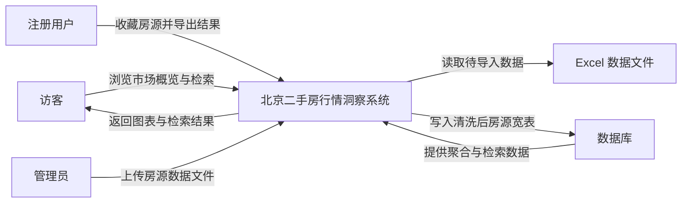
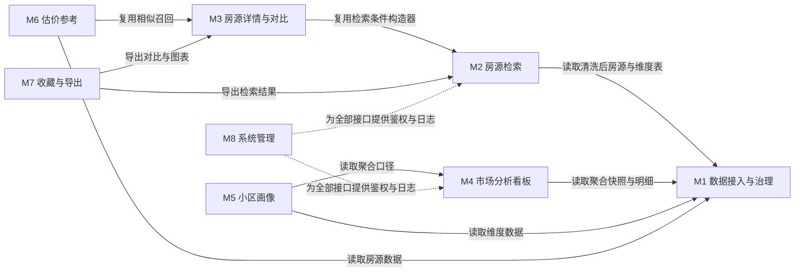

# 03 · 功能模块图

| 项 | 值 |
|---|---|
| 输入 | `docs/02-模块清单.md`（8 模块 / 46 功能点 / MoSCoW） |
| 输出 | 三张可渲染的 Mermaid 图 + 绘图说明 |
| 手册步骤 | 步骤三｜功能模块图 |
| 渲染验证 | 本机无法访问 mermaid.live，改为**语法自检脚本**（见 `tools/check_mermaid.py`），并在第 4 节说明验证边界 |

---

## 图一　系统上下文图（C4 Level 1）

三类使用者与系统交互，系统与两个外部依赖交互；每条连线都是动词短语。

**图注**：系统对访客与注册用户提供只读分析与检索；仅管理员可写入数据。
外部依赖只有两个：待导入的 Excel 文件与数据库。图中不出现任何框架名与部署细节。

---

## 图二　功能结构图（三层：系统 → 模块 → 功能点）

模块层用底色区分 MoSCoW：**Must 蓝、Should 青、Could 橙**。
M4 有 8 个功能点，按手册要求只展开前 6 个，其余折叠为"…等 2 项"。

**图例**

| 颜色 | MoSCoW | 模块 |
|---|---|---|
| 深蓝 | Must | M1 数据接入与治理、M2 房源检索、M3 房源详情与对比、M4 市场分析看板、M8 系统管理 |
| 青绿 | Should | M5 小区画像、M6 估价参考 |
| 橙色 | Could | M7 收藏与导出 |
| 灰色虚线 | 折叠 | 超过 6 个功能点的模块，其余项折叠显示 |

**图注**：46 个功能点中展开 44 个，M4 的 `FP-M4-07 楼层朝向对比` 与 `FP-M4-08 全局筛选联动` 折叠为"…等 2 项"以避免图过宽。

---

## 图三　模块依赖图

只画模块级依赖，**无环**。

**图注**：实线为数据/功能依赖，虚线为横切能力（鉴权与日志中间件）。
依赖方向单一（M1 为根，M7/M8 为叶），**逐条检查无环**：M1 不被任何模块依赖回来；
M8 只被依赖、不依赖业务模块。

### 依赖成环检查结论

| 潜在环 | 结论 |
|---|---|
| M2 ↔ M3 | 不存在：M3 依赖 M2 的 `build_filter()`，M2 不依赖 M3 |
| M4 ↔ M5 | 不存在：M5 复用 M4 的聚合口径定义，M4 不依赖 M5 |
| M3 ↔ M6 | 不存在：M6 复用 M3 的 `recall_similar()`，M3 不依赖 M6（估价结果不回写详情） |
| M7 ↔ M2/M3/M4 | 不存在：M7 只消费，不被依赖 |
| M8 ↔ 全部 | 不存在：M8 是被依赖方（横切），不发起业务调用 |

---

## 4. 绘图说明与验证边界

| 项 | 内容 |
|---|---|
| 节点数 | 图一 6 个；图二 55 个（1 系统 + 8 模块 + 46 功能点，含 1 折叠节点）；图三 8 个 |
| 连线数 | 图一 7 条；图二 53 条；图三 11 条 |
| 布局方向 | 图一 LR（数据流向从左到右）；图二 TB（层级结构自上而下）；图三 LR（依赖从左到右） |
| 字体与配色 | 正文 14px，数字 `tabular-nums`；Must `#1A4D8F`、Should `#0F766E`、Could `#B45309`、背景 `#F7F9FC` |
| 导出建议 | 图二较宽，导出 PNG 时宽度 ≥ 2400px；或用 draw.io 手工排版后导出 |
| **验证边界** | 本机网络无法访问 mermaid.live，**未做在线渲染验证**；改为 `tools/check_mermaid.py` 做语法自检（节点 ID 合法性、标签引号、括号转义、classDef 引用完整性、子图嵌套层数）。报告中如实标注此项未在线验证 |

### 自检脚本的检查项

1. 每个 `mermaid` 代码块必须有合法首行关键字（`flowchart` / `erDiagram` / `sequenceDiagram`）
2. 节点 ID 只含 `[A-Za-z0-9_]`
3. 标签内含括号/斜杠/冒号时，整个标签被双引号包裹
4. 不使用 ` ` 等 HTML 标签
5. `classDef` 定义的类名必须被 `class` 语句引用
6. `subgraph` 嵌套不超过 2 层
7. 图三依赖图无自环、无环（用拓扑排序验证）
