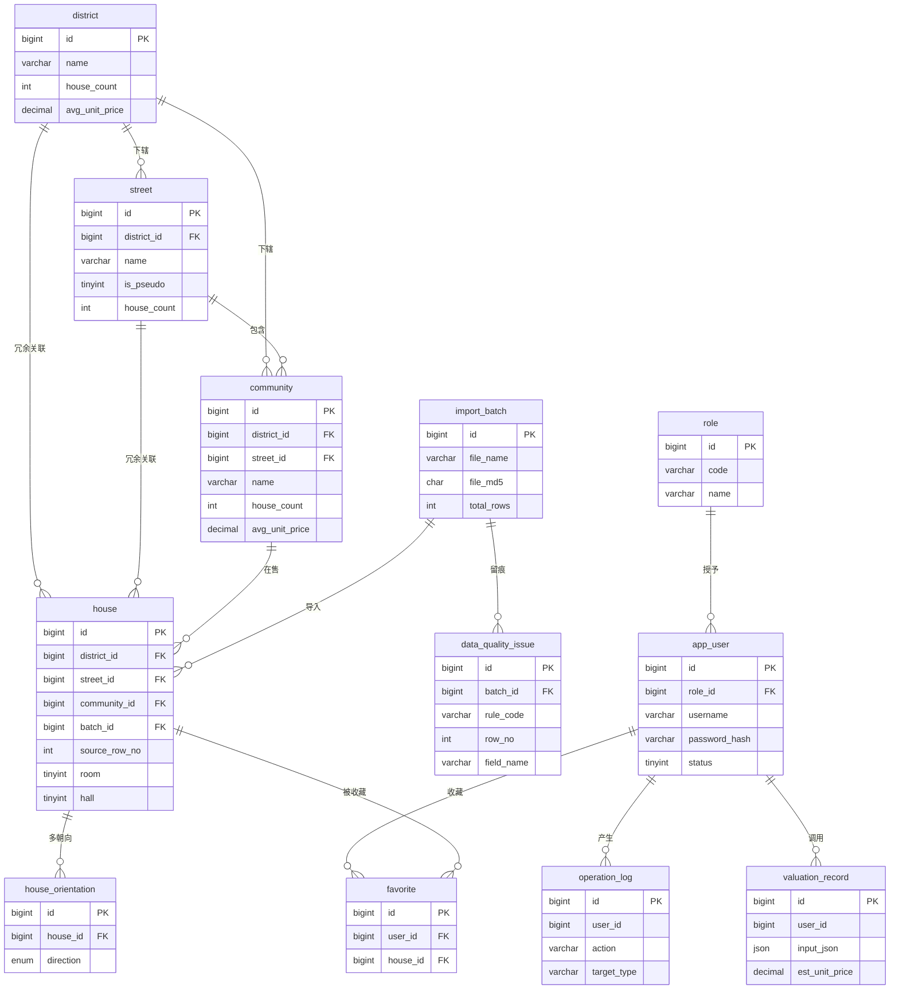

# 05 · E-R 模型与数据库设计

> 本文件由 `db/gen_schema.py` 从 `db/schema_model.py` 生成；DDL、DBML、数据字典、列映射表与本文件同源，字段名不存在漂移可能。

## 1. 概念模型

共 **12** 张表，覆盖查询、分析、对比、估价、导入治理五类场景。核心链路是 `区 → 街道 → 小区 → 房源`，朝向与收藏以 M:N 拆解。

| 表名 | 中文名 | 行数（实测/预估） | 字段数 | 说明 |
|---|---|---|---|---|
| `district` | 行政区 | 17 | 10 | 行政区（17 行，含亦庄开发区） |
| `street` | 街道/镇 | 264 | 9 | 街道/镇（264 行；街道名去重仅 237，故必须与区联合唯一） |
| `community` | 小区 | 1865 | 11 | 小区（1865 行；小区名去重 1864，绿地中央广场跨昌平/通州） |
| `house` | 房源 | 2890 | 24 | 房源主表（2890 行；district/street/community 三列为反范式冗余） |
| `house_orientation` | 房源-朝向 | 4806 | 5 | 房源-朝向关联表（4806 行）：朝向是“南 北”式多值，必须拆 M:N |
| `import_batch` | 导入批次 | 按导入次数 | 12 | 导入批次（每次 Excel 导入一行，支撑质量报告与审计） |
| `data_quality_issue` | 数据质量问题 | 按问题数 | 10 | 数据质量问题留痕（ETL 的问题台账直接落这张表） |
| `role` | 角色 | 3 | 5 | 角色（访客/注册用户/管理员） |
| `app_user` | 用户 | 按注册数 | 10 | 用户（密码用 PBKDF2-HMAC-SHA256，非明文、非 MD5） |
| `favorite` | 收藏 | 按收藏数 | 5 | 收藏（用户 × 房源 M:N 拆解，联合唯一保证幂等） |
| `operation_log` | 操作日志 | 按操作数 | 9 | 操作审计日志 |
| `valuation_record` | 估价记录 | 按估价次数 | 13 | 估价留痕（相似房源加权均价法的每次调用） |

## 2. E-R 图（Mermaid）

只画主键、外键与 3 个核心业务字段，完整字段见数据字典，避免图过密。

## 3. 关系与基数

| 主表 | 从表 | 关系 | 基数 | 说明 |
|---|---|---|---|---|
| `district.id` | `street.district_id` | 下辖 | 1:N | 街道/镇 |
| `district.id` | `community.district_id` | 下辖 | 1:N | 小区 |
| `street.id` | `community.street_id` | 包含 | 1:N | 小区 |
| `district.id` | `house.district_id` | 冗余关联 | 1:N | 房源 |
| `street.id` | `house.street_id` | 冗余关联 | 1:N | 房源 |
| `community.id` | `house.community_id` | 在售 | 1:N | 房源 |
| `import_batch.id` | `house.batch_id` | 导入 | 1:N | 房源 |
| `import_batch.id` | `data_quality_issue.batch_id` | 留痕 | 1:N | 数据质量问题 |
| `house.id` | `house_orientation.house_id` | 多朝向 | 1:N | 房源-朝向 |
| `role.id` | `app_user.role_id` | 授予 | 1:N | 用户 |
| `app_user.id` | `favorite.user_id` | 收藏 | 1:N | 收藏 |
| `house.id` | `favorite.house_id` | 被收藏 | 1:N | 收藏 |
| `app_user.id` | `operation_log.user_id` | 产生 | 1:N | 操作日志 |
| `app_user.id` | `valuation_record.user_id` | 调用 | 1:N | 估价记录 |

> 无孤立实体：`role` / `import_batch` / `app_user` 均被下游表引用；字典类小表（`role`）保持独立是因其取值需要人工维护。

## 4. 索引方案与最左前缀依据

| 表 | 索引名 | 类型 | 字段顺序 | 依据 |
|---|---|---|---|---|
| `district` | `uk_district_name` | UNIQUE | name | 区名唯一 |
| `street` | `uk_street_district_name` | UNIQUE | district_id → name | 联合唯一：同名街道可属不同区 |
| `street` | `idx_street_district` | INDEX | district_id | 按区展开街道列表（检索页联动） |
| `community` | `uk_community_district_name` | UNIQUE | district_id → name | 联合唯一：同名小区可属不同区（1 例） |
| `community` | `idx_community_street` | INDEX | street_id | 同街道小区排行（小区画像页） |
| `community` | `idx_community_name` | INDEX | name | 小区名前缀搜索；LIKE 'kw%' 可用索引，LIKE '%kw%' 不可 |
| `house` | `uk_house_batch_row` | UNIQUE | batch_id → source_row_no | 同批次内源行号唯一，保证可追溯且可重复导入不重复 |
| `house` | `idx_house_district_unit` | INDEX | district_id → unit_price | 核心查询①按区筛选并按单价排序：最左前缀 district_id 命中 WHERE，第二列直接满足 ORDER BY，避免 filesort |
| `house` | `idx_house_district_street_unit` | INDEX | district_id → street_id → unit_price | 核心查询②区+街道筛选并排序：三级最左前缀 |
| `house` | `idx_house_community_unit` | INDEX | community_id → unit_price | 核心查询③同小区相似房源召回（估价降级链第一级） |
| `house` | `idx_house_price_filter` | INDEX | total_price → area | 总价/面积区间筛选（双滑块） |
| `house` | `idx_house_age` | INDEX | house_age | 房龄段统计（看板分组） |
| `house` | `idx_house_decoration` | INDEX | decoration | 装修溢价聚合 |
| `house` | `idx_house_is_outlier` | INDEX | is_outlier | 分析层默认排除/包含极值的开关 |
| `house_orientation` | `uk_orientation_house_direction` | UNIQUE | house_id → direction | 同一房源同一方向只出现一次 |
| `house_orientation` | `idx_orientation_direction` | INDEX | direction → house_id | “朝南房源均价”这类反查：以方向为最左前缀 |
| `import_batch` | `idx_batch_created` | INDEX | created_at | 批次列表按时间倒序 |
| `data_quality_issue` | `idx_issue_batch` | INDEX | batch_id | 按批次查问题 |
| `data_quality_issue` | `idx_issue_rule` | INDEX | rule_code | 按规则统计触发次数 |
| `role` | `uk_role_code` | UNIQUE | code | 角色编码唯一 |
| `app_user` | `uk_user_username` | UNIQUE | username | 登录名唯一 |
| `app_user` | `idx_user_role` | INDEX | role_id | 按角色查用户 |
| `favorite` | `uk_favorite_user_house` | UNIQUE | user_id → house_id | 重复收藏返回成功但 already=true |
| `favorite` | `idx_favorite_house` | INDEX | house_id | 统计房源被收藏数 |
| `operation_log` | `idx_oplog_user_time` | INDEX | user_id → created_at | 按用户查操作历史 |
| `valuation_record` | `idx_valuation_time` | INDEX | created_at | 估价记录按时间倒序 |

### 4.1 四类核心查询的索引覆盖

| 核心查询 | 命中索引 | 最左前缀说明 |
|---|---|---|
| 按区 + 价格区间筛选并按单价排序 | `idx_house_district_unit` | `district_id` 命中等值条件，`unit_price` 同时满足 ORDER BY，避免 filesort |
| 按区 + 街道筛选并排序 | `idx_house_district_street_unit` | 三级最左前缀依次命中 |
| 按小区聚合均价 / 同小区相似房源 | `idx_house_community_unit` | `community_id` 等值 + `unit_price` 有序扫描，AVG 走覆盖索引前缀 |
| 小区名前缀搜索 | `idx_community_name` | `LIKE 'kw%'` 可用索引；`LIKE '%kw%'` 不可用，故接口层对关键词做前缀匹配并说明 |

### 4.2 深分页

2890 行规模下 `LIMIT offset, n` 无性能问题，但接口层仍按 keyset 方式实现（`WHERE (unit_price, id) < (?, ?)`）并在注释中说明切换条件，以应对手册要求扩展到的 100 万行。

### 4.3 覆盖索引与生成列

- 聚合查询所需列（`district_id`、`unit_price`、`total_price`、`area`）已分布在上述复合索引中，必要时可扩展为覆盖索引，但当前规模收益不明显，故不提前优化。
- `unit_price` **不改成生成列**，理由见 §6。

## 5. 明确不建的表

| 表/实体 | 不建的理由 |
|---|---|
| house_tag | 房源标签只有“近地铁/不近地铁”两值，且与 one-hot 近地铁列差异 0 条，零信息增量；已并入 house.near_subway，避免过度拆分。 |
| area_bucket / total_bucket（区间字典表） | 面积区间/总价区间为派生字段，且原始列缺 5 行（正是最大的 5 条记录）；改由前端/接口按需分桶，口径写死在 rules.toml [buckets]。 |
| price_snapshot（价格快照） | 数据是 2024-08 单一快照，无时间维度，无法建立价格时序表。 |

## 6. 设计取舍说明

### 6.1 为什么反范式（house 冗余 district_id / street_id / community_id）

房源列表的核心查询是“按区＋价格区间筛选并按单价排序”。若只留 community_id，每次检索都要 3 张表 JOIN 才能拿到区级过滤条件，执行计划无法用上 (district_id, unit_price) 复合索引。冗余三列后，区/街道/小区三级筛选都能在最左前缀上命中索引，代价是导入时统一写入、不做跨表更新——数据是只读快照，一致性风险为零。

### 6.2 为什么不存 one-hot（36 列为什么必须丢）

one-hot 把“装修”摊成 4 列后，任何“按装修分组算均价”都要写 4 个分支或 4 次 UNION；而装修“其他”列更与另三列线性相关（四列和恒为 1，549 行），属冗余基线列，保留会让任何回归/相关分析出现完全共线。丢弃后回归原文字段，分组聚合重新变成一句话，且枚举取值天然受约束。

### 6.3 为什么朝向要拆成 M:N

朝向是“南 北”这样的多值字符串，1786 条（61.8%）是多值，组合多达 61 种。不拆的话，“朝南房源的均价”这类分析根本无法表达——它会退化成对 61 个组合字符串做统计。拆成 house_orientation 后，单个方向成为一等维度，且能以 (direction, house_id) 索引反查，这正是“朝南/朝北溢价”这张图能成立的前提。

### 6.4 为什么 unit_price 用普通列而不是生成列

源数据里 单价 与 总价×10000÷面积 存在 1 元级舍入差异（最大 1.00 元/㎡，超容差 0 条）。若改为生成列，会把原始挂牌单价覆盖成计算值，等于篡改了源数据；本系统保留源值并在 ETL 层断言误差上限，既保住真实性又保住可校验性。

### 6.5 为什么不建 house_tag 表

房源标签只有“近地铁/不近地铁”两个取值，且与 one-hot 近地铁列差异 0 条，建表后每行只是重复 house.near_subway，零信息增量。这属于手册自己指出的“为好看而过度拆分”。

## 7. 方言差异（MySQL 交付 / SQLite 实跑）

| 项 | MySQL 8.0（`schema.sql`） | SQLite（`schema_sqlite.sql`） |
|---|---|---|
| 枚举 | `ENUM('低','中',...)` | `TEXT` + `CHECK (... IN (...))` |
| 定点数 | `DECIMAL(10,2)` 原生精度 | `NUMERIC`（无原生定点，靠 CHECK 与应用层） |
| 自增 | `AUTO_INCREMENT` | `INTEGER PRIMARY KEY AUTOINCREMENT` |
| 时间 | `DATETIME(3)` + `ON UPDATE` | `TEXT`(ISO-8601) + `DEFAULT strftime(...)` |
| 注释 | `COMMENT` 落库 | 由 `05-数据字典.xlsx` 承载 |
| 外键校验 | 默认开启 | 需 `PRAGMA foreign_keys = ON` |

> MySQL 版作为**交付契约**（老师按此建库）；SQLite 版用于**本机实跑验证**，两者字段名、外键、索引完全一致，由同一份 `schema_model.py` 生成。
