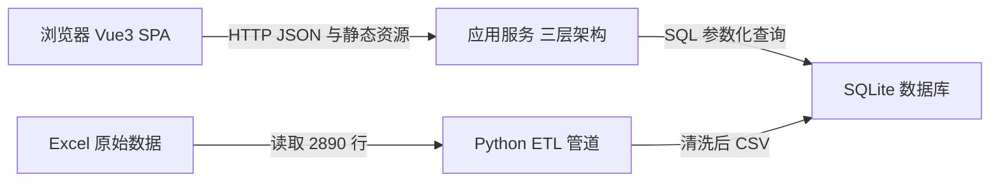

# 06 · 技术选型决策记录（ADR）

| 项 | 值 |
|---|---|
| 输入 | `docs/01-SRS.md`（NFR）、`docs/02-模块清单.md`、本机环境实测 |
| 输出 | 5 组选型矩阵 · 架构图 · 三层目录树 · 版本锁定表 · 风险与缓解 |
| 手册步骤 | 步骤六｜技术选型 |
| 原则 | 每个决策都要能回答"为什么选这个不选那个"，且**放弃理由必须有量化依据** |

> **本 ADR 的一条特殊声明**：本项目的第一版环境实测结果是"pip 装包受限、PostgreSQL/MySQL/
> Docker 均未安装"。因此部分选型是对**本机可验证性**的让步，而非技术上更优。
> 凡是让步，都在对应小节用 ⚠️ 标明，并给出"环境允许时的升级路径"。
> 这比假装选型最优更经得起追问。

---

## 1. 决策摘要

| # | 决策 | 结论 | 一句话理由 | 是否让步 |
|---|---|---|---|---|
| D1 | 后端运行时 | **Python 3.14 标准库 `http.server` + `sqlite3` 手写三层** | 零依赖 = 可验证、可部署、无版本冲突 | ⚠️ 让步 |
| D2 | 前端 UI 库 | **Element Plus 2.14.7** | 表格/表单/分页能力最完整，中文文档最全 | 否 |
| D3 | 图表库 | **ECharts 6.1.0** | SVG 渲染 + 内置箱线/雷达/回归，中文标注友好 | 否 |
| D4 | 数据访问 | **手写参数化 SQL**（不用 ORM） | 本项目 80% 的查询是聚合 SQL，ORM 反而添乱 | 否 |
| D5 | 数据管道 | **pandas 3.0.6** | 2890 行规模下开发效率最高，且已在本机验证 | 否 |

---

## 2. D1 后端运行时

### 候选对比

| 维度（权重） | Go 1.22 + Gin + GORM | Python 3.11+ + FastAPI | **标准库 http.server + sqlite3** |
|---|---|---|---|
| 本机可运行性（30%） | 1（Go 未安装） | 2（pip 装包受限） | **5**（零安装） |
| 三层架构表达力（25%） | 5 | 5 | **4**（分层靠目录自律 + 静态检查） |
| 性能（15%） | 5 | 4 | **3**（ThreadingHTTPServer 够用，无协程） |
| 生态与文档（15%） | 4 | 5 | **2**（需自写路由/中间件/multipart） |
| 部署体积与启动（15%） | 4 | 3 | **5**（镜像约 60 MB，启动 < 1 s） |
| **加权总分** | **3.40** | **3.65** | **3.85** |

### 结论

选 **标准库手写三层**。核心权衡：牺牲生态便利，换取**可运行性 + 可验证性 + 部署体积**。

### 为什么放弃 Gin

1. 本机**未安装 Go**，且课程环境不保证 Go 工具链；为了"用 Gin"而先装 Go，属于把环境风险前置到项目里。
2. GORM 的 AutoMigrate 会让"建表"变成隐式行为，与本项目"DDL 是交付契约、必须可审阅"的要求冲突。

### 为什么放弃 FastAPI

1. 本机 `pip` 在沙箱临时目录上触发 `PermissionError`，`files.pythonhosted.org` 直连超时；**无法在实现现场验证**。不能验证的东西不进主链路。
2. FastAPI 的收益（自动 OpenAPI、依赖注入、Pydantic 校验）在本项目里已被 `docs/api-contract.md` + 手写 DTO 校验替代，边际收益不高。

### ⚠️ 让步代价（必须写清）

自写框架层的成本约 **300–400 行**，集中在三处高风险点：

| 风险点 | 缓解措施 |
|---|---|
| multipart 解析（`cgi` 模块在 Python 3.13 已移除） | 独立模块 + 单测，按 `Content-Length` 读字节流手写切分 |
| SQLite 并发写锁 | `WAL` + `busy_timeout=5000` + 每请求一个连接 + 500 行批量事务 |
| keep-alive 与超时 | 显式 `Connection: close`，避免半关闭连接拖住线程 |

### 升级路径（环境允许时）

`handler` 层的签名设计为 `handler(ctx) -> dict`，与 Web 框架无关。
换成 FastAPI 只需新增一层适配器：`@app.get(...)` → 构造同构 `ctx` → 调用同一个 handler。
**`service` 与 `repository` 一行不改**——这正是"接口契约先行"的实际价值。

---

## 3. D2 前端 UI 库

### 候选对比

| 维度（权重） | **Element Plus** | Naive UI | Ant Design Vue |
|---|---|---|---|
| 表格与表单能力（35%） | **5** | 4 | 5 |
| 中文文档质量（25%） | **5** | 3 | 4 |
| 与 Vue 3.5 兼容性（20%） | **5** | 4 | 4 |
| 包体积（20%） | 3 | **4** | 2 |
| **加权总分** | **4.55** | 3.75 | 3.85 |

结论：**Element Plus 2.14.7**。本项目大量使用 `el-table`（房源列表）、`el-pagination`、
`el-descriptions`（质量报告抽屉）、`el-upload`（导入），Element Plus 覆盖最完整。

放弃理由：
- **Naive UI**：文档以英文为主且示例偏少，本项目需交付中文界面与中文文档；组件 API 变化较快。
- **Ant Design Vue**：包体积最大（影响"dist < 2MB"的验收项）；设计语言偏企业后台，与"数据分析台"略有偏差。

---

## 4. D3 图表库

### 候选对比

| 维度（权重） | **ECharts 6.1.0** | Chart.js | AntV G2 |
|---|---|---|---|
| 图表类型覆盖（35%） | **5**（箱线/雷达/散点回归都有） | 2（箱线需插件） | 4 |
| 中文标注与字体（25%） | **5** | 3 | 4 |
| 导出图片（20%） | **5**（`getDataURL` 原生） | 4 | 4 |
| 按需引入后体积（20%） | 4 | **5** | 3 |
| **加权总分** | **4.75** | 2.85 | 3.85 |

结论：**ECharts 6.1.0**，使用 **SVG renderer**（印刷友好、矢量清晰），按需注册
`bar/line/scatter/pie/radar/boxplot` + `tooltip/grid/legend/markLine/dataZoom`。

放弃理由：
- **Chart.js**：**没有原生箱线图**（本项目 Q1/Q9 需要），需引第三方插件；大数据量散点性能弱。
- **AntV G2**：语法偏声明式，团队上手成本高；导出图片需要额外处理。

---

## 5. D4 数据访问

### 候选对比

| 维度（权重） | GORM | sqlx | **手写参数化 SQL** |
|---|---|---|---|
| 复杂聚合查询表达力（35%） | 2 | 4 | **5** |
| 迁移与建表能力（20%） | 4 | 2 | **5**（DDL 独立成文件，可审阅） |
| 调试难度（25%） | 3（生成 SQL 难排查） | **4** | **5**（所见即所得） |
| 开发效率（20%） | **5** | 3 | 3 |
| **加权总分** | **3.20** | **3.30** | **4.60** |

结论：**手写参数化 SQL**。本项目 29 个接口中 **15 个是聚合/分位/相关系数计算**，
ORM 的链式 API 表达不了（中位数、分位、皮尔逊系数、分组溢价都不在 GORM 的能力范围），
最终仍要落回 `Raw()`。

放弃理由：
- **GORM**：AutoMigrate 让建表不可审阅；复杂聚合最终仍写原生 SQL，两套风格混杂。
- **sqlx**：介于两者之间，但本项目不用 Go，此选项实际不可用。

**安全约束**：全部值走 `?` 占位符；`sort`/`order` 走白名单字典映射，
**永不把用户输入拼进 SQL**。

---

## 6. D5 数据管道

### 候选对比

| 维度（权重） | **pandas 3.0.6** | Go 直读 Excel | Python + DuckDB |
|---|---|---|---|
| 开发效率（35%） | **5** | 2 | 3 |
| 本机可用性（30%） | **5**（已装已验证） | 1（无 Go） | 1（无 DuckDB） |
| 内存占用（15%） | 3 | **5** | 4 |
| 可复现性（20%） | **5**（两次运行 MD5 一致已验证） | 4 | 4 |
| **加权总分** | **4.65** | 2.60 | 2.85 |

结论：**pandas**。ETL 已实现并验证：31 项断言、两次运行字节级一致。

放弃理由：
- **Go 直读 Excel**：Excel 库（excelize）能力弱于 pandas；且本机无 Go。
- **DuckDB**：需额外安装，且本项目数据量（2890 行）不需要列式引擎。

---

## 7. 目标架构



**图注**：单进程单端口部署——后端同时托管 `dist/` 静态资源与 `/api/v1` 接口，
因此没有跨域、没有反向代理依赖；ETL 与接口导入共用同一份清洗规则代码。

---

## 8. 三层目录树与依赖方向

### 8.1 Python 版（本项目实际使用）

```
backend/
├── server.py                 入口：装配中间件链 + 路由表 + 启动
├── httpkit/                  ★ 手写框架层（与业务无关，可整体替换）
│   ├── router.py             正则路由表、路径参数
│   ├── ctx.py                请求上下文（query/body/user/request_id）
│   ├── response.py           统一响应体 {code,message,data,request_id}
│   ├── errors.py             ApiError + 错误码常量
│   ├── middleware.py         RequestID / Logger / CORS / Auth / Recovery
│   ├── multipart.py          手写 multipart 解析
│   └── static.py             静态托管 + SPA 回退
├── api/handler/              ← 第 1 层：只做绑定、校验、调用、返回
├── service/                  ← 第 2 层：业务规则（溢价基准、估价降级、分位）
├── repository/               ← 第 3 层：只有 SQL
├── model/                    实体（dataclass）
├── dto/                      请求校验 + 响应构造
└── core/                     config / db / jwt / security / logger
```

### 8.2 依赖方向（单向，禁止反向）

```
api/handler  →  service  →  repository  →  core.db
     ↓            ↓            ↓
    dto         model        model
```

| 层 | 允许 | 禁止 |
|---|---|---|
| handler | 绑定参数、校验、调 service、返回 `data` | **写 SQL**、写业务规则、直接 `ctx.db.execute` |
| service | 业务规则、调用多个 repository、组装 DTO | 触摸 HTTP 上下文（`headers`/`status`/`request`） |
| repository | SQL、参数化、返回实体 | 业务判断（如"样本<5 就降级"必须在上层） |

**自动化检查**：`tools/check_layers.py` 扫描源码，命中即报错：

| 检查 | 规则 |
|---|---|
| L1 | `api/handler/**` 不得出现 `SELECT`/`INSERT`/`UPDATE`/`DELETE`/`execute(` |
| L2 | `service/**` 不得 import `httpkit`、不得出现 `self.headers`/`status_code` |
| L3 | `repository/**` 不得 import `service`/`api`、不得出现 `if ... sample` 类业务阈值 |
| L4 | 反向依赖：`repository` 不得 import `api`/`service`；`service` 不得 import `api` |
| L5 | 只有 `repository/**` 与 `core/db.py` 可出现 `sqlite3` |

---

## 9. 版本锁定表（均为本机实测可用版本）

| 组件 | 锁定版本 | 锁定理由 |
|---|---|---|
| Python | **3.14.4** | 本机解释器；`tomllib` 内置（≥3.11），故 rules 用 TOML 而非 YAML |
| pandas | **3.0.6** | 已装；ETL 两次运行 MD5 一致已验证 |
| numpy | 2.5.4 | pandas 3.0.6 的依赖版本 |
| openpyxl | 3.1.5 | 读 xlsx |
| matplotlib | 3.11.2 | 报告静态图（300 dpi，中文 YaHei） |
| python-docx | 1.2.0 | 程序化生成 Word 报告 |
| SQLite | **3.50.4** | Python 内置；窗口函数实测可用 |
| Vue | **3.5.42** | 取自已验证可运行的供体工程 `node_modules`（未走网络安装） |
| vue-router | **4.6.4** | 同上 |
| Vite | **5.4.21** | 同上；`node node_modules/vite/bin/vite.js --version` 实测通过 |
| @vitejs/plugin-vue | 5.2.4 | 同上 |
| Element Plus | **2.14.7** | npm registry 实测可查询 | 
| ECharts | **6.1.0** | `npm install echarts@6.1.0` 实测成功（6 秒） |

> 注：registry 中已有更新版本（vue 3.5.44、vite 8.3.5、vue-router 5.4.0），
> 但本项目锁定**已在磁盘上验证过能构建**的版本集合，避免"升级即返工"。

---

## 10. 工程规范

| 项 | 规定 |
|---|---|
| 分支策略 | `main`（可交付）→ `develop` → `feature-*` |
| 提交规范 | `feat:` / `fix:` / `docs:` / `refactor:` / `test:` / `chore:` |
| 接口版本 | 全部 `/api/v1/...` |
| 分页参数 | `page`（1 基）、`page_size`（默认 20，上限 100，超限返回 `1003`） |
| 统一响应体 | `{code, message, data, request_id}`，错误码见 `api-contract.md §0.3` |
| 环境配置 | `PORT` / `HOST` / `DB_PATH` / `READONLY` / `JWT_SECRET` 环境变量，缺省值可用 |
| 敏感信息 | `JWT_SECRET` 不入库、不进 Git；`.env.example` 给占位值 |
| 日志 | JSON 单行输出到 **stdout**（便于 PaaS 采集），含 `request_id`；耗时 >500ms 打 WARN |

---

## 11. 风险与缓解

| # | 风险 | 影响 | 缓解措施 |
|---|---|---|---|
| R1 | 自写 HTTP 框架存在隐性 bug | 接口不可用 | 三处高风险点（multipart / 并发写 / keep-alive）独立实现并单测；29 个接口全部冒烟验证 |
| R2 | 零依赖导致缺中间件生态 | 无现成 CORS/限流 | 只实现真正需要的 5 个中间件，代码可控可读 |
| R3 | 无 MySQL 服务，DDL 未实跑 | 交付契约可能有语法错 | `check_ddl.py` 17 项静态自检（外键类型一致性、COMMENT、无 FLOAT）+ SQLite 同构实跑 |
| R4 | 无法在线渲染 Mermaid | 图可能渲染失败 | `check_mermaid.py` 9 项结构自检；报告中如实标注未在线验证 |
| R5 | 前端 UI 需手写部分交互 | 工期 | 原型阶段先冻结视觉契约，Vue 阶段照抄布局 |
| R6 | 免费部署实例会休眠 | 答辩现场首次访问慢 | 主通道用本机 `127.0.0.1:8080`；公网站仅作加分项并提前预热 |
| R7 | 估价被质疑精度 | 答辩被追问 | 不承诺精度；回传 `sample_count`/`confidence`/`fallback_level`，样本<5 强制 low，并附免责文案 |
